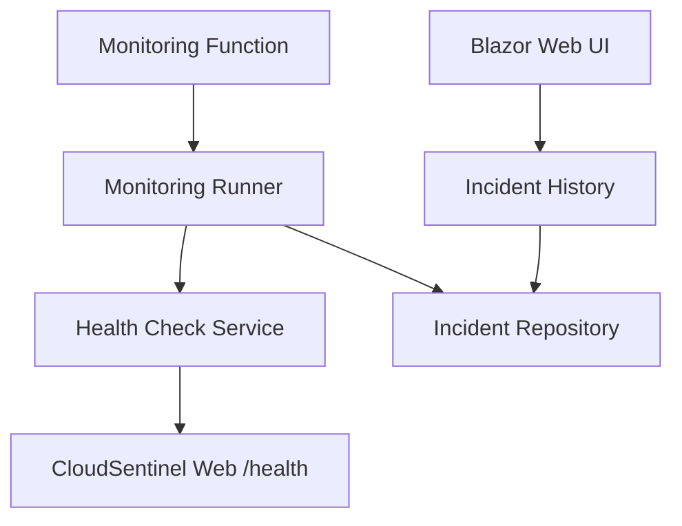

# CloudSentinel

**Version:** v0.1 — Local Ready  
**Technology:** C# / .NET 10 / Blazor / Docker / Terraform  
**Cloud provider:** Google Cloud Platform (planned deployment)

## Overview

CloudSentinel is a lightweight monitoring and incident detection application designed for services hosted on Google Cloud Run.

The application checks service availability, detects failures and prepares the foundation for automated remediation.

Version 0.1 currently supports local execution and integration testing using Docker. Cloud deployment and automated traffic rollback have not yet been verified in Google Cloud.

## Architecture



The local solution consists of four projects:

- **CloudSentinel.Core** — monitoring, incident management and remediation logic.
- **CloudSentinel.Functions** — HTTP monitoring function and Google Cloud integrations.
- **CloudSentinel.Web** — Blazor application with an incident history view.
- **CloudSentinel.Tests** — automated xUnit tests.

## Requirements

- .NET 10 SDK
- Docker Desktop
- Git
- Terraform (for infrastructure validation)

## Local execution

Build the Docker images from the solution root:

```powershell
docker build -f Dockerfile.web -t cloudsentinel-web:local .
docker build -f Dockerfile.functions -t cloudsentinel-functions:local .
```

Create the shared Docker network:

```powershell
docker network create cloudsentinel-net
```

Start the web application:

```powershell
docker run -d --rm --name cloudsentinel-web --network cloudsentinel-net -p 8081:8080 cloudsentinel-web:local
```

Start the monitoring function:

```powershell
docker run -d --rm --name cloudsentinel-functions --network cloudsentinel-net -p 8085:8080 -e MONITORED_HEALTH_URL=http://cloudsentinel-web:8080/health cloudsentinel-functions:local
```

## Local endpoints

| Endpoint | Purpose |
|---|---|
| http://localhost:8081/incidents | Blazor incident history |
| http://localhost:8081/health | Web application health check |
| http://localhost:8085 | Trigger monitoring function |

The monitoring function returns the number of incidents detected during the current execution.

## Tests

Run automated tests:

```powershell
dotnet test CloudSentinel.Tests/CloudSentinel.Tests.csproj
```

The last verified local test run completed successfully with **49 passing tests**.

### Docker integration test

1. Start both containers.
2. Invoke `http://localhost:8085` — expected result: 0 incidents.
3. Stop `cloudsentinel-web`.
4. Invoke the function again — expected result: 1 incident.
5. Restart the web container.
6. Invoke the function again — expected result: 0 incidents.

This scenario has been successfully verified locally.

## Continuous Integration

GitHub Actions automatically:

- Restores dependencies.
- Builds the .NET solution.
- Runs automated tests.
- Builds both Docker images.

The CI pipeline has been verified successfully.

## Google Cloud — planned deployment

The repository includes Terraform configuration for Google Cloud resources and application integrations for Cloud Run, Cloud Monitoring and Firestore.

The planned cloud deployment includes scheduled monitoring through Cloud Scheduler, persistent incident storage and controlled traffic rollback to a previously verified healthy revision.

These cloud capabilities require deployment and end-to-end verification.

**Current status:** Local Ready. Google Cloud deployment not performed.

## Future documentation updates

After deployment, update this README with:

- Google Cloud project and deployment configuration.
- Cloud Run service URLs.
- Cloud Scheduler configuration.
- Firestore integration verification.
- Traffic rollback test results.
- Deployment and operational instructions.