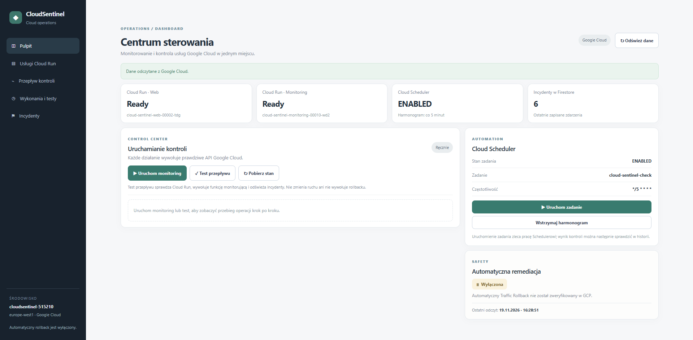
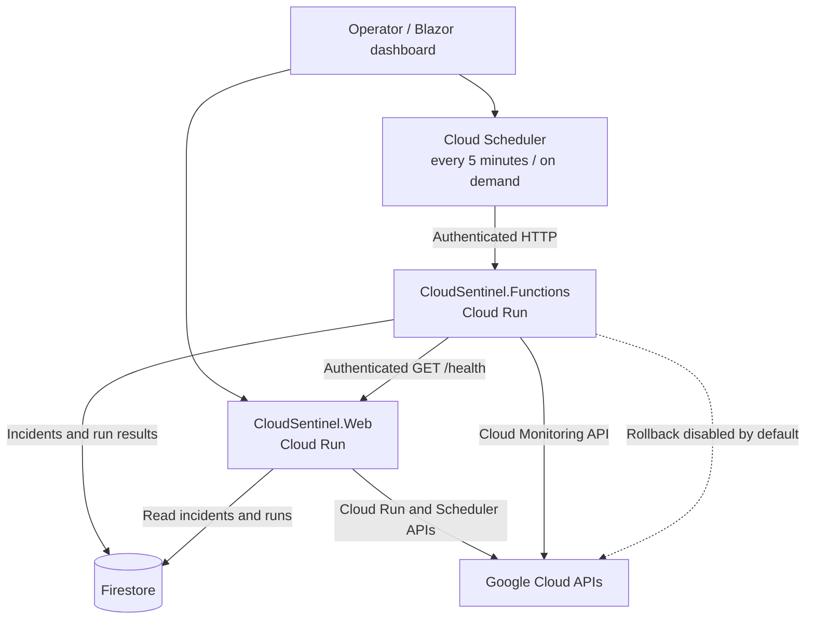

# CloudSentinel

**Cloud Run monitoring and operations dashboard built with C# / .NET 10, Blazor and Google Cloud.**

CloudSentinel checks the availability of a monitored Cloud Run service, records incidents in Firestore and provides an operator dashboard for viewing service status, revisions, scheduled checks and monitoring history. The dashboard can also request a monitoring run and manage the Cloud Scheduler job when authorized.

> **Project status — November 2026:** Deployed on Google Cloud with known limitations. Automatic traffic rollback is implemented but **not verified in a real Google Cloud test** and remains disabled. The browser-facing IAP/OAuth configuration is **not completed** (HTTPS access was returning HTTP 403). Do not treat this project as a production-ready remediation system.

## Screenshots

The screenshots below are loaded from the repository's **`screenshots/`** directory. Generate this gallery using the included `Update-ReadmeScreenshots.ps1` script after copying screenshots into that directory.

<!-- SCREENSHOTS:START -->
### Historia incydentów


### Przepływ kontroli


### Pulpit



### Usługi Cloud Run


### Wykonania i testy


<!-- SCREENSHOTS:END -->

## Features

| Area | Function | Status |
|---|---|---|
| Dashboard | Cloud Run service status, revisions and traffic split | Implemented; API access depends on IAM |
| Monitoring | Health checks and on-demand checks | Tested |
| Automation | HTTP Cloud Scheduler every five minutes | Tested, HTTP 200 confirmed |
| Incidents | Firestore incident records | Tested |
| Execution history | `monitoring_runs`, including successful checks | Implemented; verify live data after final Functions deployment |
| Notifications | Optional webhook notifications | Implemented; configure `WEBHOOK_URL` if needed |
| Traffic rollback | Manual revision traffic switch | Tested |
| Auto-remediation | Previous verified revision and attempt limiting | **Disabled; not verified end-to-end** |
| UI HTTPS login | Cloud Run + Identity-Aware Proxy | **Incomplete; HTTP 403 / OAuth setup** |
| CI | GitHub Actions build, test and image builds | Tested |

## Architecture



The architecture uses server-side Google Cloud credentials. No GCP secret keys should be embedded in the Blazor client or committed to the repository.

## Repository layout

```text
CloudSentinel/
├── CloudSentinel.Core/            # Models, checks, incident processing
├── CloudSentinel.Functions/       # HTTP monitoring function, Google Cloud integrations
├── CloudSentinel.Web/             # Blazor Interactive Server dashboard
├── CloudSentinel.Tests/           # Automated tests
├── infra/                         # Terraform for Google Cloud
├── screenshots/                   # Dashboard and cloud deployment screenshots
├── .github/workflows/            # CI workflow
├── Dockerfile.web
├── Dockerfile.functions
├── terraform.tfvars.example
├── Update-ReadmeScreenshots.ps1   # Generates screenshot gallery from actual filenames
└── DEPLOY.md                      # Build, deploy, access and verification
```

## Stack

- **C# / .NET 10**, ASP.NET Core, Blazor Interactive Server, xUnit
- **Google Cloud Run**, Cloud Scheduler, Cloud Monitoring, Firestore, Artifact Registry, IAM
- **Docker**, **Terraform**, GitHub Actions

## Run locally

Requirements: .NET 10 SDK, Docker Desktop (optional), and an authenticated Google Cloud CLI for live cloud data.

```powershell
dotnet restore CloudSentinel.slnx
dotnet build CloudSentinel.slnx -c Release
dotnet test CloudSentinel.Tests/CloudSentinel.Tests.csproj -c Release
dotnet run --project CloudSentinel.Web
```

To read real Google Cloud data from the local dashboard, configure Application Default Credentials and the project ID. The local dashboard's ability to invoke protected resources depends on the account's Google Cloud permissions.

```powershell
gcloud auth application-default login
gcloud auth application-default set-quota-project cloudsentinel-515210
```

Do not commit local credentials or `terraform.tfvars`.

## Google Cloud deployment

The deployed project uses `cloudsentinel-515210` in `europe-west1`. See **[DEPLOY.md](DEPLOY.md)** for commands to build and publish the Web UI, update the Cloud Run deployment, configure protected access and verify services.

**Access note:** The standard HTTPS Cloud Run URL does not currently provide a confirmed working browser login. The IAP/OAuth configuration must be completed before advertising it as a public-facing portfolio demo. Do **not** use `--allow-unauthenticated` on a panel that can manage cloud resources.

## Screenshots maintenance

Place `.png`, `.jpg`, `.jpeg`, `.webp` or `.gif` images in `screenshots/` and run:

```powershell
./Update-ReadmeScreenshots.ps1
```

This regenerates the screenshots section using the **actual filenames**, correctly URL-encoded for GitHub. Commit both `README.md` and `screenshots/` afterward.

## Security and limitations

- Automatic remediation must remain disabled (`REMEDIATION_ENABLED=false`) until a controlled end-to-end rollback test passes.
- Cloud Run's `Ready` status means the service is deployed; it is not equivalent to a completed application-level health check.
- Starting a Cloud Scheduler job confirms that a request was accepted, **not** that monitoring completed. Confirm completed runs in `monitoring_runs` or Cloud Logging.
- Browser access with IAP is not complete; resolve OAuth client setup and re-test authorization before wider sharing.
- Manual `gcloud run services update` changes can produce Terraform drift. Inspect `terraform plan` before any future `terraform apply`.
- Billing budgets send alerts; they are not a hard spending cap.

## License

No license has been assigned. Contact the repository owner before reusing the source code beyond what GitHub's terms allow.
